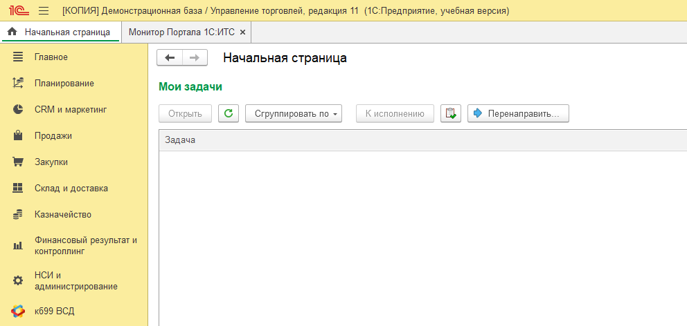
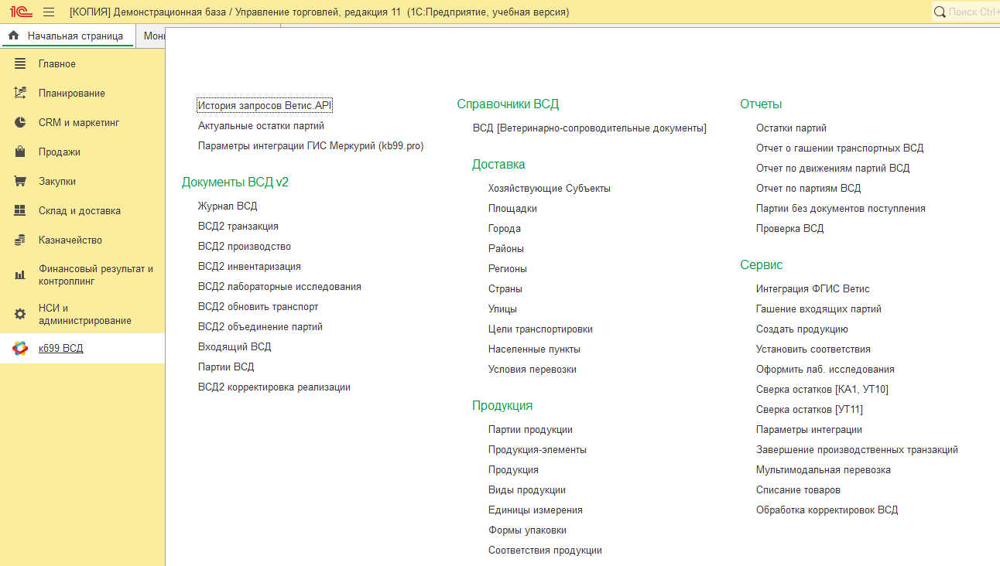
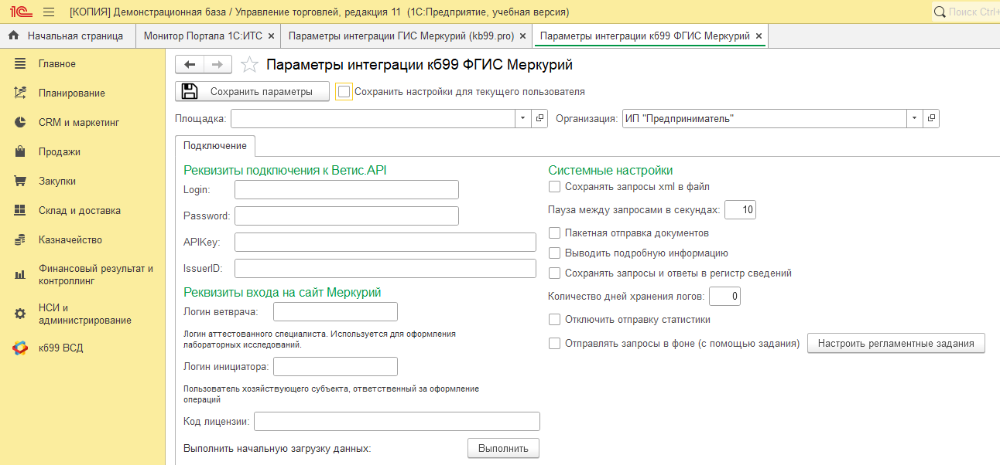
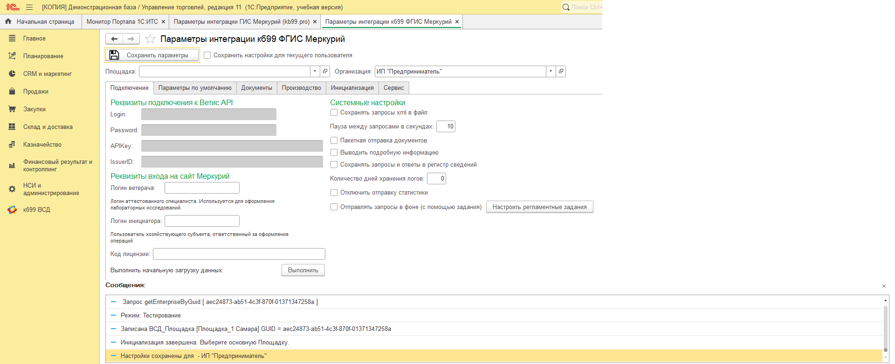
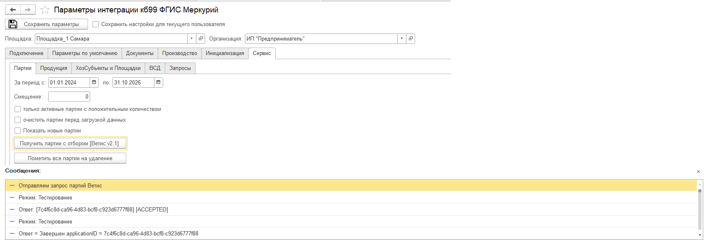
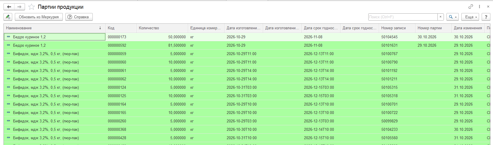
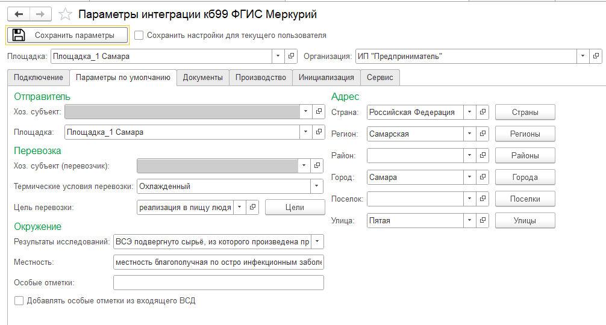
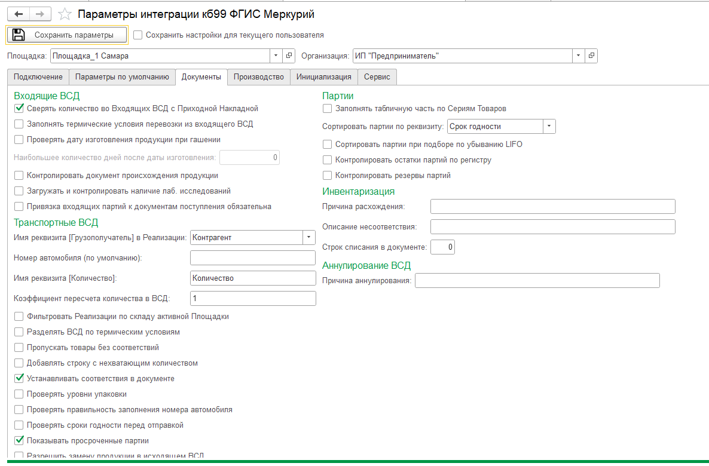
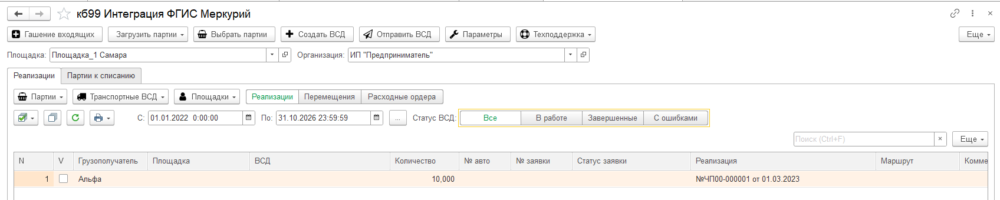

# Отчёт по лабораторной работе

**ФИО:** ____________________  
**Неделя / Лаба:** Задача со звёздочкой: установка интеграции кб99 ФГИС «Меркурий» в демо-конфигурацию «Управление торговлей 11.5»  
**Цель работы:** Установить модуль интеграции кб99 «ВетИС» в демонстрационную базу УТ 11.5, подключить его к тестовому контуру ФГИС «Меркурий» и настроить параметры интеграции. Зафиксировать, что получилось настроить и что нет.

## Исходные данные

| Что | Значение |
|---|---|
| Конфигурация | 1С:Управление торговлей, ред. 11, версия **11.5.11.70**, демо-база (файловая, 3,5 ГБ, режим совместимости 8.3.17) |
| Модуль интеграции | `Ветис.cf` — конфигурация «Интеграция_кб99_Ветис» (kb99.pro), версия **3.0.3.260811**, режим совместимости 8.3.14 |
| Платформа | Конфигуратор 8.3.27.2170. Режим 1С:Предприятие запускался на учебной версии 8.3.25.1286: у полной платформы нет лицензии |
| Контур «Меркурия» | Тестовый. Реквизиты Ветис.API выданы преподавателем; в отчёт они не включены, на скриншотах закрыты |

## Шаги воспроизведения

### 1. Подготовка
1. Демо-база распакована из архива в отдельную папку. С копией можно экспериментировать, исходный архив остаётся резервной копией. УТ сама помечает базу как «[КОПИЯ]».
2. `Ветис.cf` загружен во временную пустую базу и выгружен в файлы. Так можно посмотреть его состав: 254 объекта метаданных, корневая подсистема `кб99_ВСД`.
3. Составы двух конфигураций сравнены:
   - 72 объекта есть в обеих. Это заглушки типовых объектов внутри `Ветис.cf`: справочники Номенклатура, Организации, Контрагенты, документы РеализацияТоваровУслуг, ПриобретениеТоваровУслуг, общие модули БСП и т.п. Реквизитов интеграции в них нет, только стандартные.
   - 182 объекта новые.

### 2. Установка (объединение конфигураций)
Инструкция kb99 предлагает «Сравнить, объединить с конфигурацией из файла» → «Отметить по подсистемам файла» → только «кб99_ВСД». Я сделал то же самое в пакетном режиме Конфигуратора, через выгрузку и загрузку XML:

1. В набор вошла подсистема `кб99_ВСД` со всеми вложенными подсистемами (СправочникиВСД, ДокументыВСДv2, Команды, ОтчетыВСД, ДокументыВСДv1, УстаревшиеВерсии), их состав и все объекты, на которые они ссылаются по типам и из модулей. Получилось **173 объекта**:
   - 33 общие картинки;
   - 24 общих модуля `ВетИС_*`;
   - 21 справочник `ВСД_*`;
   - 21 общая команда;
   - 16 документов `ВСД*`;
   - 14 обработок;
   - 9 перечислений;
   - 9 отчётов;
   - 7 общих форм;
   - 7 регламентных заданий;
   - 5 регистров сведений;
   - 2 регистра накопления;
   - 2 роли `кб99_*`;
   - журнал документов, группа команд и сама подсистема.

   Полный список — в файле `docs/ut-vetis-perenesennye-obekty.txt`.
2. Не переносились:
   - **Заглушки типовых объектов.** Остались объекты УТ, иначе типовые объекты заменились бы на урезанные. Это соответствует пункту инструкции о снятии отметки с «Интеграция_кб99_Ветис».
   - **Объекты вне подсистемы `кб99_ВСД`.** Это подсистема `ТиповыеДокументы`, роль `Администратор`, справочник `СпецификацииНоменклатуры` и регистр `кб99_ОрганизацияПоУмолчанию`. Модули интеграции на них не ссылаются.
3. Объекты загружены в конфигурацию УТ частичной загрузкой `/LoadConfigFromFiles … -listFile … -partial` от имени пользователя демо-базы «Администратор (ОрловАВ)». Конфигуратор выдал два предупреждения «Неизвестный объект метаданных — Configuration.Интеграция_кб99_Ветис». Это ссылки на корень исходной конфигурации интеграции, на работу они не влияют. Аналог окна «Неразрешимые ссылки → Продолжить» из инструкции.
4. Структура базы обновлена командой `/UpdateDBCfg`: созданы таблицы новых справочников, документов, регистров и регламентных заданий. Изменения приняты без ошибок.
5. Синтаксический контроль модулей всей конфигурации (`/CheckModules -ThinClient -Server`) пишет: **«Синтаксических ошибок не обнаружено!»**.

### 3. Запуск и настройка параметров
1. УТ запущена в режиме 1С:Предприятие на учебной платформе 8.3.25. В панели разделов появился раздел **«кб99 ВСД»** (рисунок 1). В нём есть меню с документами ВСД v2, справочниками, отчётами и сервисными обработками (рисунок 2).
2. Открыта обработка **кб99 ВСД → Сервис → Параметры интеграции**. До первой загрузки в ней видна только вкладка «Подключение» (рисунок 3).
3. **Вкладка «Подключение».**
   - Заполнены Login, Password, APIKey, IssuerID тестового Ветис.API.
   - Поле «Код лицензии» оставлено пустым: для тестового контура он не нужен.
   - Нажаты «Сохранить параметры» и «Выполнить» (начальная загрузка).
   - Загрузка заняла несколько минут. Всё это время окно 1С не отвечало: обмен идёт синхронно, но процесс работал, а не висел.
   - Результат (рисунок 4): «Режим: Тестирование», запрос `getEnterpriseByGuid`, «Записана ВСД_Площадка [Площадка_1 Самара]», «Инициализация завершена», «Настройки сохранены для ИП "Предприниматель"». После этого появились остальные вкладки: «Параметры по умолчанию», «Документы», «Производство», «Инициализация», «Сервис».
4. **Основная площадка.** В поле «Площадка» выбрана «Площадка_1 Самара», параметры сохранены.
5. **Проверка обмена — «Сервис → Партии»**, период 01.01.2024–31.10.2026, «Получить партии с отбором [Ветис v2.1]».
   - Первая попытка: заявка принята (ACCEPTED), потом **отклонена**. Причина: не был заполнен «Логин инициатора».
   - Логин инициатора (учётная запись Ветис.Паспорта) заполнен, запрос повторён. Ответ «**Завершен**» (рисунок 5).
   - Из «Меркурия» загружены реальные партии тестовой площадки: «Бедро куриное», «Бифидок мдж 3,2%» и др., с количеством, датами изготовления и сроками годности (рисунок 6).
   - В ходе обмена загружен хозяйствующий субъект (его GUID совпадает с IssuerID).
6. **Вкладка «Параметры по умолчанию»** (рисунок 7):
   - отправитель — хозсубъект тестовой учётной записи и «Площадка_1 Самара»;
   - перевозчик — тот же хозсубъект;
   - термические условия «Охлаждённый»;
   - цель перевозки «Реализация в пищу людям». Справочник целей загружен из «Меркурия» кнопкой «Цели».
   - Адрес (Российская Федерация, Самарская обл., Самара) заполнился автоматически по площадке.
7. **Вкладка «Документы»** (рисунок 8):
   - «Имя реквизита [Грузополучатель] в Реализации» = `Контрагент`;
   - «Имя реквизита [Количество]» = `Количество` (реквизиты табличной части «Товары» документа РеализацияТоваровУслуг в УТ);
   - коэффициент пересчёта 1;
   - включены «Сверять количество во Входящих ВСД с Приходной Накладной» и «Устанавливать соответствия в документе»;
   - «Показывать просроченные партии» включено по умолчанию.
8. **Проверка связи с документами УТ.** Открыто рабочее место **«кб99 Интеграция ФГИС Меркурий»** (Сервис → Интеграция ФГИС Ветис), период расширен до 01.01.2022. В списке реализаций появился документ УТ **«№ЧП00-000001 от 01.03.2023»**, грузополучатель «Альфа», количество 10 (рисунок 9). Значит, интеграция читает типовые документы УТ.

## Что должно получиться

- Ожидаемый результат/данные:
  - конфигурация УТ дополнена подсистемой «кб99 ВСД», типовые объекты не изменены, ошибок синтаксиса нет;
  - соединение с тестовым Ветис.API работает: площадка, хозсубъект, цели перевозки и партии загружаются;
  - параметры по умолчанию и параметры документов сохранены для организации ИП «Предприниматель».

## Что получилось и что не получилось

| Пункт | Результат |
|---|---|
| Установка подсистемы «кб99_ВСД» в УТ 11.5.11 без изменения типовых объектов | ✅ получилось |
| Обновление структуры БД, синтаксический контроль | ✅ без ошибок |
| Запуск УТ с интеграцией на учебной платформе 8.3.25 | ✅ получилось |
| Вкладка «Подключение», начальная загрузка | ✅ получилось, режим «Тестирование» |
| Основная площадка, хозсубъект | ✅ загружены из «Меркурия» |
| Загрузка партий площадки | ✅ со второй попытки, после заполнения логина инициатора |
| «Параметры по умолчанию» (отправитель, перевозчик, условия, цель, адрес) | ✅ заполнены и сохранены |
| «Документы» (реквизиты реализации, контроль количества, соответствия) | ✅ заполнены и сохранены |
| Рабочее место интеграции видит реализации УТ | ✅ получилось |
| «Производство» | ➖ не настраивалось: в торговле нет производства |
| Логин ветврача | ➖ не заполнялся: нужен только для лабораторных исследований |
| Оформление и отправка транспортного ВСД по реализации | ❌ не делалось. Нужны соответствия номенклатуры УТ и продукции «Меркурия» и привязка контрагента «Альфа» к площадке получателя в «Меркурии». Тестовых данных получателя нет |
| Регламентные задания, отправка запросов в фоне | ❌ не настраивалось: в файловой базе на учебной платформе регламентные задания не выполняются |
| Расширение с переопределёнными функциями (`.cfe`) | ❌ не подключалось: в поставке только `.cf`, а расширение по инструкции нужно для «Управления нашей фирмой» |

## Замеченные ошибки/ограничения
- **Пароль и APIKey видны открытым текстом.** Поле «Password» на вкладке «Подключение» не маскируется: пароль виден любому, кто открыл форму. На скриншотах отчёта эти поля закрыты вручную.
- **Окно зависает на время обмена.** Начальная загрузка и запросы выполняются синхронно, окно 1С не отвечает несколько минут. Можно включить «Отправлять запросы в фоне (с помощью задания)», но для этого нужен работающий планировщик регламентных заданий.
- **Отказ без объяснения.** При пустом «Логине инициатора» запрос партий отклоняется («Отклонен applicationID = …») без текста причины в сообщениях. Причину пришлось определять методом исключения.
- **Ограничения учебной платформы.** Учебная версия не даёт печатать и сохранять табличные документы. Полная 8.3.27 без лицензии запускает только Конфигуратор.
- **Режим поддержки не трогал.** Инструкция kb99 требует включить «возможность изменения» в настройке поддержки. Я ставил объекты частичной загрузкой XML, и пакетный режим не потребовал менять поддержку. При обновлении УТ объединение нужно будет повторить.
- **Устаревшие имена в документации.** На docs.kb99.pro модуль переопределений называется `кб99_ВСД_Переопределения`, а в версии 3.0.3 это `ВетИС_ПереопределенияСервер`.

## Вывод (коротко)
- Получилось:
  - модуль интеграции кб99 «ВетИС» 3.0.3 установлен в демо-УТ 11.5.11 без изменения типовых объектов;
  - подключение к тестовому «Меркурию» работает: загружены площадка, хозсубъект, цели перевозки и партии продукции;
  - заполнены вкладки «Подключение», «Параметры по умолчанию», «Документы»;
  - интеграция видит реализации УТ.
- Что улучшить:
  - сопоставить номенклатуру УТ с продукцией «Меркурия» и привязать контрагентов к площадкам;
  - оформить и отправить тестовый транспортный ВСД;
  - развернуть базу на сервере 1С, чтобы работали регламентные задания и фоновая отправка.
