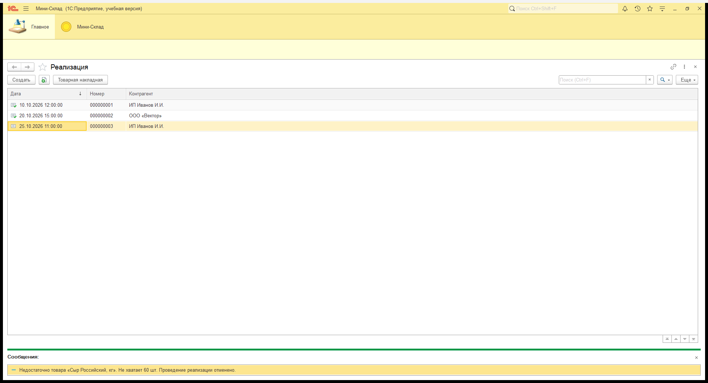
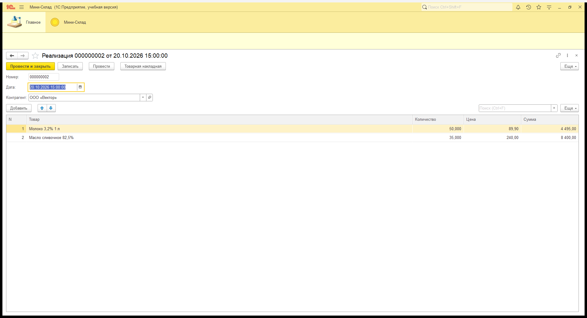
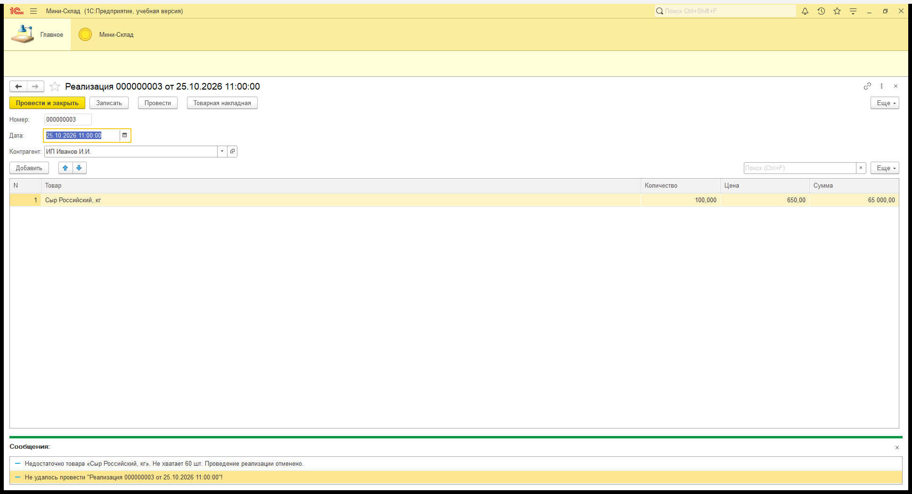
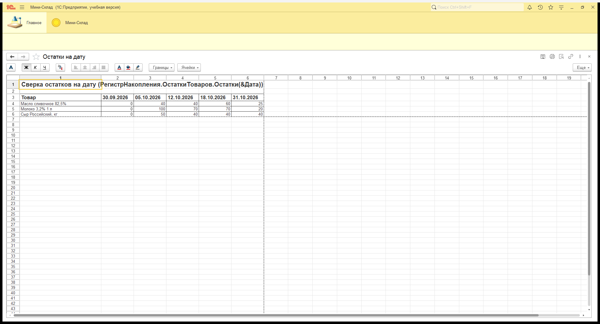
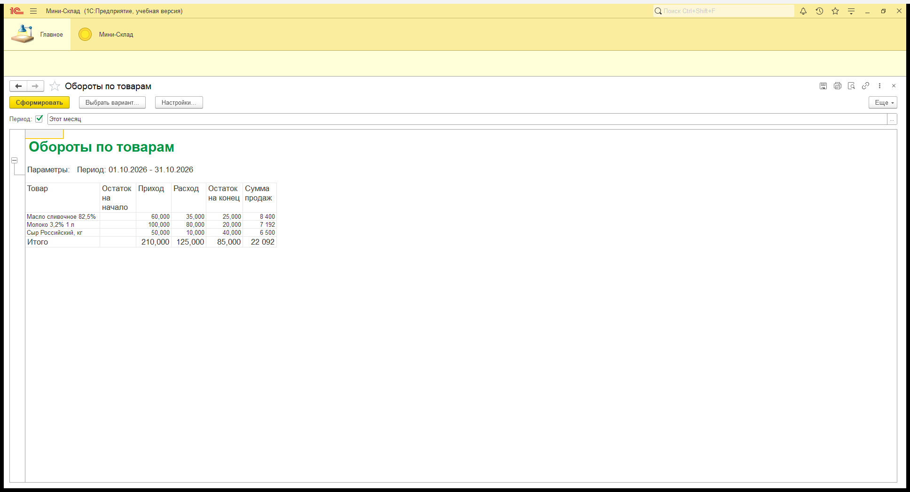
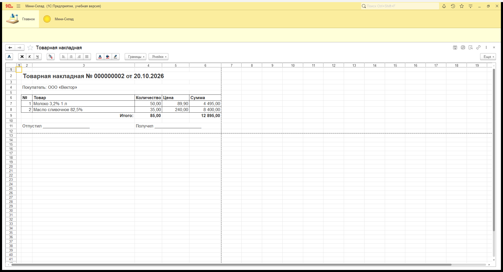

# Отчёт по лабораторной работе

**ФИО:** ____________________  
**Неделя / Лаба:** Практика: пункты 1–2 (регистры остатков и оборотов, СКД-отчёт, печатная форма)  
**Цель работы:** Добавить в конфигурацию «Мини-Склад» регистр оборотов рядом с регистром остатков, провести документы и сверить остатки на дату. Сделать СКД-отчёт «Обороты по товарам» и печатную форму документа «Реализация».

## Что сделано в конфигурации

| Объект | Что изменено |
|---|---|
| Регистр накопления **ОстаткиТоваров** (вид «Остатки») | Без изменений. Измерение «Товар», ресурс «Количество». Приход делает «Поступление», расход делает «Реализация». |
| Регистр накопления **ПродажиТоваров** (вид «Обороты») | Новый. Измерения: «Товар», «Контрагент». Ресурсы: «Количество», «Сумма». |
| Документ **Реализация** | В табличную часть «Товары» добавлены «Цена» и «Сумма». Сумма считается в `ПередЗаписью` по формуле Количество × Цена. Документ делает движения по обоим регистрам. Если товара не хватает, проведение отменяется (контроль был и раньше). |
| Отчёт **ОборотыПоТоварам** | Новый, на СКД. Источник — виртуальная таблица `ОстаткиТоваров.ОстаткиИОбороты`, к ней присоединены `ПродажиТоваров.Обороты`. Параметр «Период» (стандартный период) задаёт `НачалоПериода` и `КонецПериода`. Колонки: остаток на начало, приход, расход, остаток на конец, сумма продаж. Группировка по товару, в конце итоги. |
| Документ **Реализация**: макет **ТоварнаяНакладная** и команда **ПечатьНакладной** | Табличный макет с областями «Заголовок», «ШапкаТаблицы», «Строка», «Подвал». Команда стоит в командной панели формы документа (кнопка «Товарная накладная»). Процедура печати находится в модуле менеджера документа (`ПечатьНакладной`). |
| Подсистема **МиниСклад** | В неё добавлены регистр «Продажи товаров» и отчёт «Обороты по товарам». |

Исходники лежат в `configuration/`. Это выгрузка Конфигуратора 8.3.27 (`/DumpConfigToFiles`). Рядом лежит `configuration/конф.cf`.

## Шаги воспроизведения
1. Создайте пустую файловую базу. Откройте её в Конфигураторе: **Конфигурация → Загрузить конфигурацию из файлов…**, укажите папку `configuration`. Нажмите **F7** и примите изменения. Второй вариант: **Конфигурация → Загрузить конфигурацию из файла…** с файлом `конф.cf`.
2. Запустите 1С:Предприятие и откройте раздел **Мини-Склад**.
3. Заполните справочники:
   - Товары: «Молоко 3,2% 1 л», «Сыр Российский, кг», «Масло сливочное 82,5%».
   - Контрагенты: «ООО «Молочный завод»», «ИП Иванов И.И.», «ООО «Вектор»».
4. Введите и проведите документы:

   | Дата | Документ | Контрагент | Товары |
   |---|---|---|---|
   | 01.10.2026 | Поступление | ООО «Молочный завод» | Молоко 100, Сыр 50, Масло 40 |
   | 10.10.2026 | Реализация | ИП Иванов И.И. | Молоко 30 × 89,90; Сыр 10 × 650 |
   | 15.10.2026 | Поступление | ООО «Молочный завод» | Масло 20 |
   | 20.10.2026 | Реализация | ООО «Вектор» | Молоко 50 × 89,90; Масло 35 × 240 |
   | 25.10.2026 | Реализация | ИП Иванов И.И. | Сыр 100 × 650 (больше остатка) |

5. Сверьте остатки на дату. Откройте список регистра «Остатки товаров» или выполните запрос к `РегистрНакопления.ОстаткиТоваров.Остатки(&Дата)` для дат 30.09, 05.10, 12.10, 18.10 и 31.10.
6. Откройте отчёт **Обороты по товарам**, задайте период 01.10.2026–31.10.2026 и нажмите **Сформировать**.
7. Откройте реализацию от 20.10.2026 и нажмите кнопку **Товарная накладная**.
8. Автоматическая проверка: шаги 3–7 можно выполнить сценарием `tests/practice-registers-report.bsl`. Его нужно запускать в отдельной тестовой базе как серверный общий модуль с функцией `Запустить()`.

## Что должно получиться

Скриншоты сняты в 1С:Предприятии (учебная версия 8.3.25) на базе с данными из шагов 3–4.

- Скрин 1: список реализаций. Документы от 10.10 и 20.10 проведены. Документ от 25.10 записан, но не проведён: товара не хватает, и система выдала сообщение об этом.

  

- Скрин 2: реализация от 20.10.2026. Сумма в строках считается как количество × цена. Кнопка «Товарная накладная» стоит в командной панели.

  

- Скрин 3: попытка провести реализацию от 25.10.2026 на 100 кг сыра. Контроль остатков отменяет проведение: «Не хватает 60 шт.»

  

- Скрин 4: сверка остатков на дату по `РегистрНакопления.ОстаткиТоваров.Остатки(&Дата)`. Цифры совпали с ручным расчётом на всех пяти датах (`PASS: остатки на все даты совпали`):

  

  | Товар | 30.09 | 05.10 | 12.10 | 18.10 | 31.10 |
  |---|---|---|---|---|---|
  | Молоко 3,2% 1 л | 0 | 100 | 70 | 70 | 20 |
  | Сыр Российский, кг | 0 | 50 | 40 | 40 | 40 |
  | Масло сливочное 82,5% | 0 | 40 | 40 | 60 | 25 |

- Скрин 5: отчёт «Обороты по товарам» за октябрь 2026. Пустая колонка «Остаток на начало» означает ноль.

  

- Скрин 6: печатная форма «Товарная накладная» для реализации от 20.10.2026.

  

- Ожидаемый результат/данные:
  - Конечный остаток в отчёте равен остатку на 31.10.
  - Сумма продаж в отчёте равна сумме движений регистра «Продажи товаров» за период.
  - Синтаксический контроль модулей (`/CheckModules`) пишет «Синтаксических ошибок не обнаружено!». Проверка конфигурации (`/CheckConfig`) пишет «Ошибок не обнаружено».

## Замеченные ошибки/ограничения
- В учебной версии платформы (8.3.25, 1cv8t) табличный документ нельзя напечатать или сохранить в файл (PDF, MXL). В форме его можно только посмотреть. Поэтому сценарий проверки выводит содержимое отчёта и накладной текстом, а результат показан скриншотами окна.
- Полная платформа 8.3.27 без лицензии запускает только Конфигуратор. Поэтому выгрузку делал Конфигуратор 8.3.27, а прогон в режиме Предприятия — учебная 8.3.25. Перед загрузкой в 8.3.25 у копии выгрузки понижалась версия формата (2.20 → 2.18).
- В регистре остатков нет ресурса «Сумма». Поэтому отчёт показывает обороты в количестве, а сумму только по продажам. Себестоимость не считается.
- Цена в реализации вводится вручную. Справочника цен нет.
- Сумма в строке пересчитывается при записи документа, а не сразу при вводе в форме. Формы стандартные, автогенерируемые.

## Вывод (коротко)
- Получилось:
  - Документы делают движения по регистрам остатков и оборотов.
  - Остатки на произвольную дату получаются из виртуальной таблицы `Остатки(&Дата)` и совпадают с ручным расчётом.
  - СКД-отчёт собирает остатки и обороты за период в одну таблицу с итогами.
  - Печатная форма строится по макету с именованными областями.
- Что улучшить:
  - Добавить ресурс «Сумма» в регистр остатков для учёта себестоимости.
  - Сделать форму документа с пересчётом суммы при вводе.
  - Добавить в отчёт вариант с группировкой по контрагентам из регистра «Продажи товаров».
  - Вынести печать в общий механизм печати.
